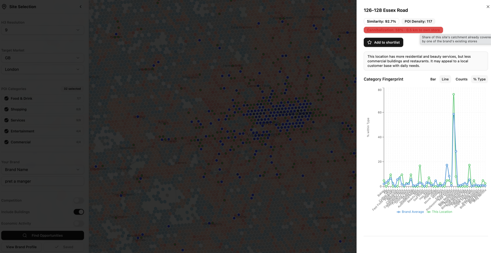

# Execution evidence

Everything in this folder is read back from a live deployment by
[`scripts/capture_evidence.py`](../../scripts/capture_evidence.py). The
deployment is workspace `fevm-geo-sme-emea`, catalog
`geo_sme_emea_catalog.site_selection`, bundle target `dev`. Re-run the script
against your own deployment to regenerate it.

| File | What it shows |
|---|---|
| [01_etl_job_run.md](01_etl_job_run.md) | End-to-end Lakeflow Job run: every task, result and duration |
| [02_pipeline_data_quality.md](02_pipeline_data_quality.md) | Lakeflow Declarative Pipeline update: rows per dataset, expectation pass/fail counts from the event log |
| [03_gold_tables.md](03_gold_tables.md) | Governed silver/gold tables in Unity Catalog: row counts, city-footprint sources, samples |
| [04_hex2vec_model.md](04_hex2vec_model.md) | Trained Hex2Vec model artifacts and training metadata (37 cities) |
| [05_genie_agent.md](05_genie_agent.md) | Genie Agent answering natural-language questions, with the SQL it generated and the results |
| [06_app_analysis.md](06_app_analysis.md) | A live app analysis (Pret A Manger → London): progress stream, top sites with cannibalization, drill-down, shortlist, Save Analysis |
| [07_lakebase.md](07_lakebase.md) | Lakebase rows written by the app: sessions, scored hexagons, shortlist |

_Live app screenshot: a London candidate site at 58% cannibalization, 0.5 km from the nearest existing Pret._
